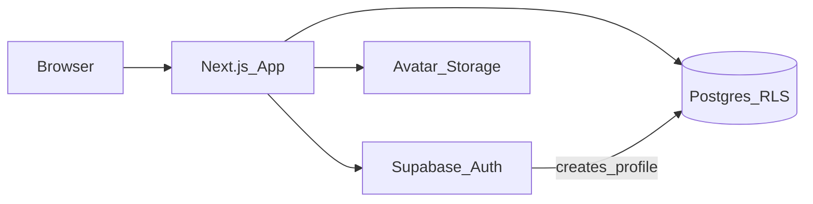
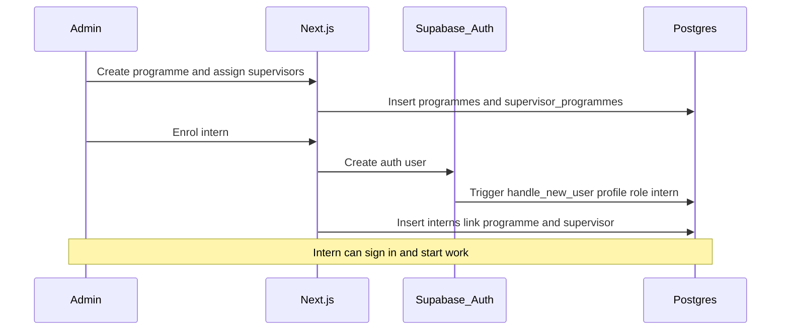
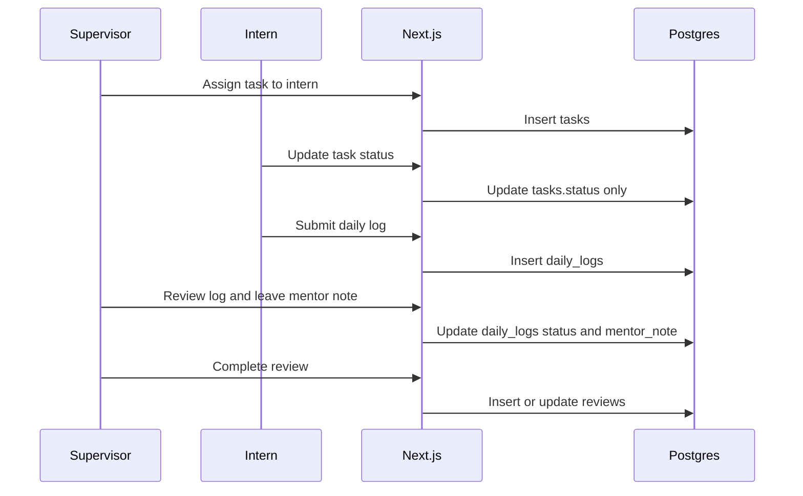
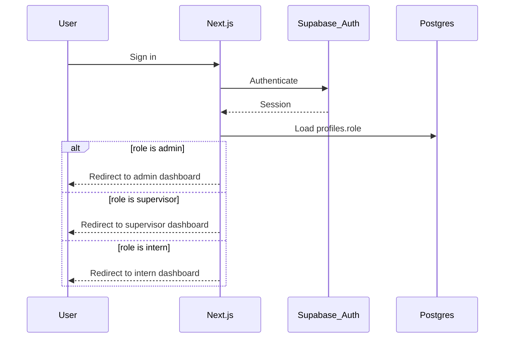
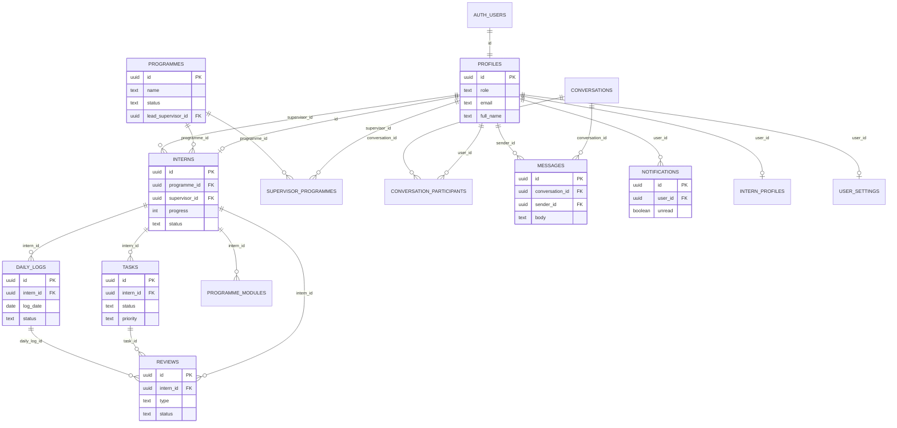

# InkDot Inc. — Intern Management System

A simple platform to manage interns, supervisors, programmes, and reports in one place. Enrol cohorts, assign mentors, track tasks and daily logs, and keep reviews moving without chasing updates across chats and spreadsheets.

## Features

- **Programmes** — Set up cohorts, capacity, and supervisor coverage
- **Day-to-day work** — Assign tasks, collect daily logs, and follow mentorship
- **Reviews & progress** — Track feedback, outcomes, and programme health
- **Messaging & notifications** — Keep admins, supervisors, and interns aligned
- **Role dashboards** — Dedicated workspaces with charts, metrics, and recent activity
- **Reports** — Programme insights and activity in one view

## Roles

| Role | Responsibility |
| --- | --- |
| **Admin** | Create accounts, enrol interns, and keep programmes running |
| **Supervisor** | Assign work, review daily logs, and guide interns through each cohort |
| **Intern** | Track tasks, submit logs, and follow progress from day one to close out |

## Tech stack

- **Frontend** — Next.js 16, React 19, Tailwind CSS, shadcn/ui
- **Backend** — Supabase Auth + Postgres (RLS, migrations, seed)

## Architecture



Role-based access is enforced in Postgres with RLS helpers (`current_role`, `is_admin`, `is_supervisor_of`) plus column-guard triggers so interns can only update allowed fields.

## Security model

- **RLS by role** — Every core table uses Postgres Row Level Security. Access is scoped with helpers such as `current_role()`, `is_admin()`, and `is_supervisor_of()`.
- **Signup is locked down** — `handle_new_user` always creates a `profiles` row with role `intern`. Signup metadata cannot self-promote.
- **Admins alone change roles** — The `protect_profile_role` trigger blocks non-admins from updating `profiles.role`.
- **Column guards** — Interns may update only allowed fields (for example `tasks.status`). Supervisors cannot rewrite intern log content; they review status and mentor notes.
- **Service role is server-only** — `SUPABASE_SERVICE_ROLE_KEY` is used for admin auth-user create/delete on the server. It must never ship to the browser.

## How the system works

### Programme lifecycle



### Daily mentoring loop



### Authentication and routing



## Entity relationship diagram

Core domain model (simplified):



## Repository structure

```
.
├── client/          # Next.js app (Supabase Auth + Postgres)
└── supabase/        # SQL migrations, seed, and setup notes
```

## Prerequisites

- Node.js 20+ and npm
- A Supabase project with SQL Editor access
- Environment values from the Supabase project settings (URL, publishable/anon key, service role key)

## Quick start

### 1. Database

Follow [supabase/SUPABASE_SETUP.md](supabase/SUPABASE_SETUP.md):

1. Run migrations in order: `0001` → `0002` → `0003` → `0004`
2. Create auth users in the Supabase dashboard
3. Optionally run `seed.sql` for demo data

### 2. Frontend

```bash
cd client
npm install
# add .env.local (see below)
npm run dev
```

Useful scripts from `client/`:

| Script | Purpose |
| --- | --- |
| `npm run dev` | Local development server |
| `npm run build` | Production build |
| `npm run lint` | ESLint |
| `npm run typecheck` | TypeScript (`tsc --noEmit`) |

Open [http://localhost:3000](http://localhost:3000).

## Environment

Create `client/.env.local`:

```env
NEXT_PUBLIC_SUPABASE_URL=https://YOUR_PROJECT.supabase.co
NEXT_PUBLIC_SUPABASE_PUBLISHABLE_KEY=your_anon_or_publishable_key
SUPABASE_SERVICE_ROLE_KEY=your_service_role_key
```

The service role key is only used for admin server actions (create/delete auth users). Never expose it in the browser.

## Demo users

Create these Auth users first, then run `seed.sql` to promote roles and load sample programmes, tasks, logs, and reviews. Use passwords you control locally — none are stored in the repo.

| Role | Email |
| --- | --- |
| Admin | `admin@inkdot.com` |
| Supervisor | `jordan.peters@inkdot.com` |
| Supervisor | `aisha.naidoo@inkdot.com` |
| Intern | `nomsa.khumalo@inkdot.com` |
| Intern | `thabo.molefe@inkdot.com` |
| Intern | `lerato.dlamini@inkdot.com` |
| Intern | `zanele.botha@inkdot.com` |
| Intern | `ethan.jacobs@inkdot.com` |

Full migration notes and a smoke checklist are in [supabase/SUPABASE_SETUP.md](supabase/SUPABASE_SETUP.md).
